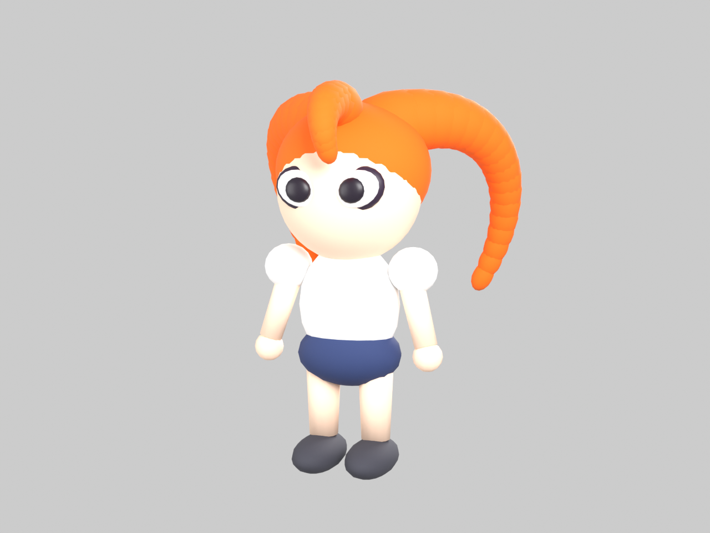

# Inkling Model（インクリング風 3D モデル）

Blender で作成した、インクリング風のローポリ 3D キャラクターモデルです。オレンジ色のインクの髪、スリムなボディ、斜めにつり上がった目が特徴です。すべてプリミティブ（球・円錐）から Python スクリプトで生成しています。



## ファイル構成

| パス | 内容 |
|---|---|
| `inkling.blend` | Blender 用のシーンファイル（モデル、ライト、カメラを含む） |
| `export/inkling.glb` | glTF Binary 形式の書き出し（Web ビューアやゲームエンジン向け） |
| `render/inkling_render.png` | レンダリングのプレビュー画像 |
| `build_inkling.py` | 上記をすべて再生成する Blender 用 Python スクリプト |

## Blender で開く

1. Blender をインストールします（<https://www.blender.org/>）。
2. `File > Open` で `inkling.blend` を選びます。
3. `.glb` だけ使う場合は、`File > Import > glTF 2.0` で `export/inkling.glb` を選びます。
   three.js などの glTF 対応ビューアにもそのまま読み込めます。

## build_inkling.py で再生成する

Blender をコマンドラインから、バックグラウンドで実行します。

```bash
blender --background --python build_inkling.py
```

実行すると、スクリプトと同じ場所に `inkling.blend`、`export/inkling.glb`、`render/inkling_render.png` が上書き生成されます。
